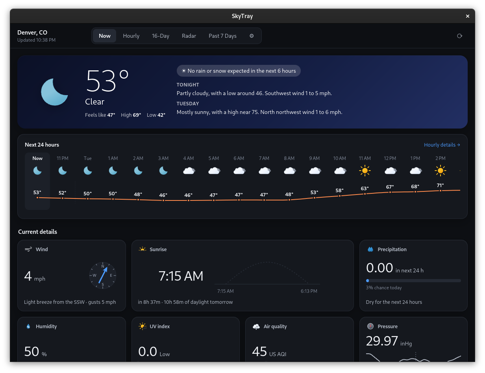
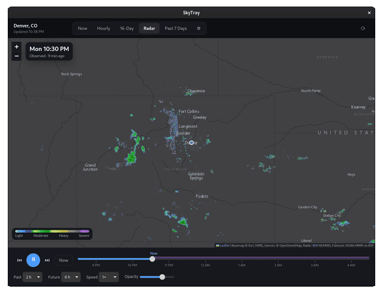
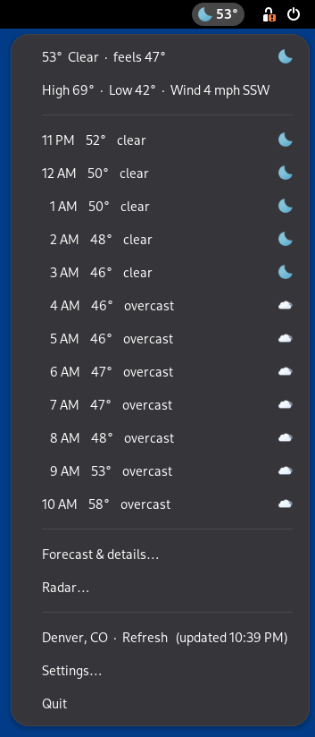
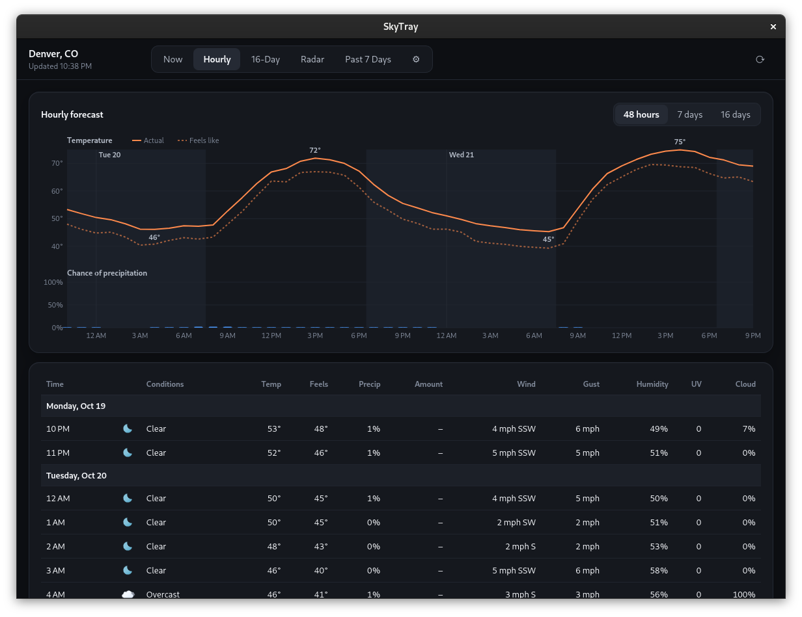
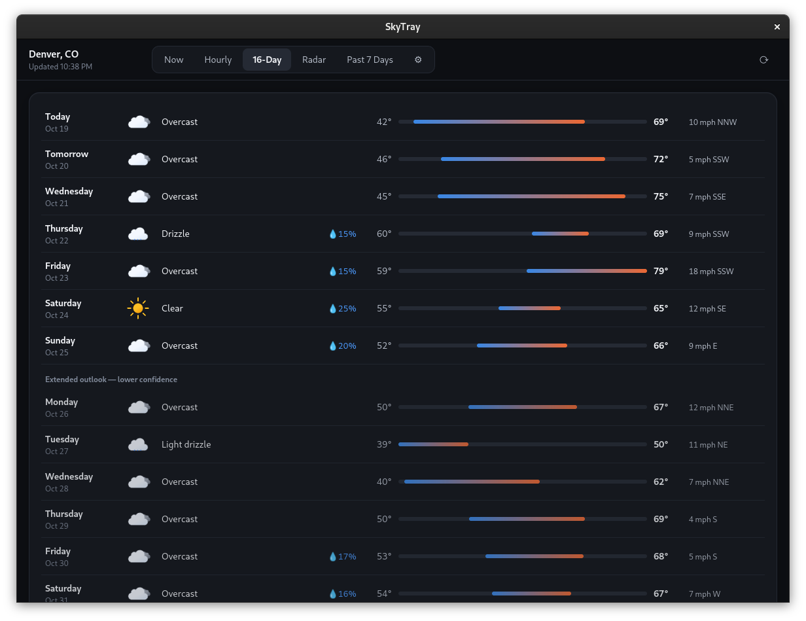

<h1 align="center">SkyTray</h1>
<p align="center"><b>The weather in your top bar, with a radar you can play.</b><br>
A weather indicator for the GNOME desktop on Ubuntu. No accounts, no API keys.</p>



SkyTray shows a condition icon and the temperature in the top bar all the time.
One click shows the next 12 hours. The forecast window has today at a glance,
hourly charts, a 16-day outlook, the past week, and an animated radar you can
play and scrub, including where the rain is headed next.

<p align="center"></p>

## What it does

- **Top bar:** the condition icon (colour, or monochrome to match GNOME) and
  the temperature. A ⚠ appears while a weather alert is active.
- **Click for the menu:**
  - current conditions, feels-like, today's high and low, and wind
  - when rain or snow is about to start or stop ("Rain starting around
    3:15 PM")
  - any weather alerts
  - the next 12 hours (you can change how many)
  - Forecast & details…, Radar…, Refresh, Settings…, Quit
- **The forecast window:**
  - **Now:** current conditions, the National Weather Service's forecast in
    words, a 6-hour rain chart when rain is expected, the next 24 hours, and
    tiles for wind, humidity, pressure, UV, clouds and visibility,
    sunrise and sunset, air quality and the moon.
  - **Hourly:** temperature and feels-like, plus the chance of rain, as
    charts you can hover, for 48 hours, 7 days or 16 days, with a full table
    below.
  - **16-Day:** each day's low and high on a range bar. Click a day for its
    forecast in words and its hours. Days 8–16 are marked as less certain.
  - **Past 7 Days:** total rain, the warmest, coldest and wettest days, and
    charts of the week.
  - **Radar:** the last 1–24 hours of radar, then up to 18 hours of forecast
    radar (purple). Play, pause, step or drag through time; change the speed
    and opacity. Keys: Space plays or pauses, ←/→ step, N jumps to now.
  - **Alerts:** only while an alert is active.
  - **⚙ Settings:** search for a city or ZIP code, or use your approximate
    location; °F or °C; icon style; how often to refresh; menu length; start
    at login.

<table>
<tr>
<td></td>
<td><br><br>
</td>
</tr>
</table>

**Outside the US:** the forecast, charts, past week and radar history work
anywhere. Weather alerts, the forecast in words and forecast radar come from
US services, so they only appear for US locations, and the radar there shows
the past couple of hours only.

## Install

Requirements: Ubuntu 24.04 or 26.04 (or another GNOME desktop) with the
AppIndicator extension enabled. Ubuntu has it on by default.

```bash
sudo apt install python3-gi python3-gi-cairo gir1.2-gtk-3.0 gir1.2-webkit2-4.1 gir1.2-ayatanaappindicator3-0.1
git clone https://github.com/GAServantes/skytray.git ~/skytray
~/skytray/install.sh          # app menu entry, `skytray` command, start at login; starts it
~/skytray/install.sh --remove # undo (your settings stay in ~/.local/share/skytray)
```

The app runs from the cloned folder, so keep it there. On first run it uses
your approximate location (see Privacy); change it any time under ⚙ Settings.

From a terminal: `skytray [--details | --radar | --refresh | --quit]`. These
are passed to the running copy.

## Privacy

SkyTray has no account and no server of its own. It only talks to the
weather services below, and sends them the coordinates of the place you
chose.

The one exception is finding your location. When no location is set yet, or
when you click "Use my IP location", it asks ipinfo.io (or ipwho.is if that
fails) over HTTPS for the approximate, city-level location of your internet
connection. Pick a place by name instead and that lookup never happens.

Settings stay on your computer in `~/.local/share/skytray/`.

| What | From |
|---|---|
| Forecast, past week, air quality, place search | [Open-Meteo](https://open-meteo.com) |
| US alerts and forecast in words | [National Weather Service](https://www.weather.gov/documentation/services-web-api) |
| US radar and forecast radar (HRRR) | [Iowa Environmental Mesonet](https://mesonet.agron.iastate.edu) |
| Radar outside the US | [RainViewer](https://www.rainviewer.com/api.html) |
| Map | Esri |

## Development

[docs/DEVELOPMENT.md](docs/DEVELOPMENT.md) covers how it's put together, the
data sources in detail, test instances that don't touch your real settings,
and the gotchas.

## License

SkyTray is free software under the **GNU General Public License v3.0 or later**
(see `LICENSE`). You can use, study, share and modify it; if you distribute a
modified version, it must also be under the GPL with its source available.

Copyright (C) 2026 G. Austin Servantes.

Bundled third-party parts keep their own licenses: Meteocons icons (MIT,
`icons/meteocons/LICENSE`) and Leaflet (BSD-2-Clause, `vendor/LICENSE-leaflet`).
Both are GPL-compatible. Weather, radar and map data come from the services
listed above under their own terms of use.

## Changelog

- **1.3.1** (2026-10-20):
  - Finding your location from your IP address now uses HTTPS (ipinfo.io,
    with ipwho.is as a fallback) instead of plain http to ip-api.com.
  - Screenshots, a Privacy section and an "Outside the US" note in the
    README; the developer notes moved to `docs/DEVELOPMENT.md`.
  - Checked on Ubuntu 26.04 (GNOME 50).
- **1.3** (2026-10-19): review fixes.
  - A fetch that was running when you changed location or units no longer
    overwrites the new settings with old-place data (it used to also block the
    new fetch for up to 10 minutes). Forced refreshes queue behind a running one.
  - The NWS point lookup is cached from the main thread instead of the worker.
  - A failed "Use my IP location" no longer retries forever when a location is
    already set.
  - The window follows the system light/dark switch live; the WebKit background
    matches the page (no flash).
  - Radar refreshes itself every 5 minutes while the tab is open (when paused),
    and keyboard controls no longer double-fire on focused buttons or sliders.
  - Location search ignores out-of-order responses; small guards for missing
    data.
  - `install.sh`, `.gitignore` and the Leaflet license for publishing;
    `SKYTRAY_HOME` test instances get their own cache.
- **1.2** (2026-09-29): redesign. Condition-tinted header; a 24-hour strip
  with a temperature curve; detail tiles each with their own graphic (wind
  compass, sun arc, UV and air-quality scales, pressure trend, moon phases)
  and a plain-words note. The last good forecast is kept and shown with a
  notice when a fetch fails.
- **1.1** (2026-09-29): Past 7 Days tab; radar history up to 24 hours.
- **1.0** (2026-09-29): tray icon and temperature, hourly menu, rain/snow
  timing, weather alerts, the forecast window (Now, Hourly, 16-Day, Alerts,
  Settings), and radar with past scans and HRRR forecast frames you can play
  and scrub.
